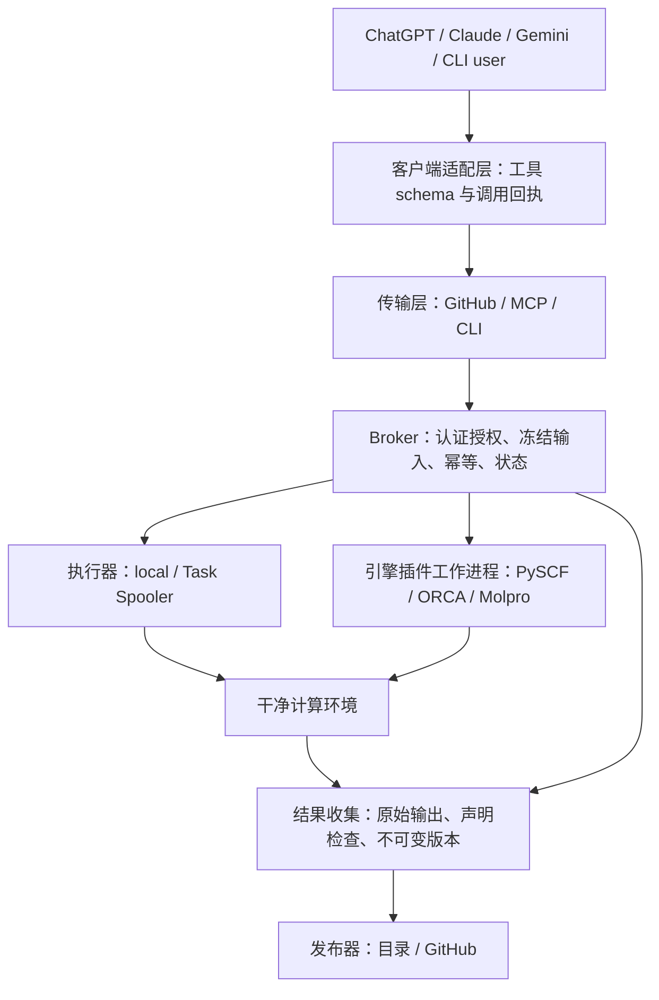

# chat-hpc-control v0.1 架构说明

- 日期：2026-10-21
- 状态：用户于 2026-10-21 确认架构，随后批准全部实施并选择 Native。实现进展与证据见 `docs/implementation-progress.md`；不构成生产部署或外部发布声明
- 项目名／拟用发行名／CLI 名：`chat-hpc-control`
- Python 命名空间：`chat_hpc_control`
- 协议：`chat-hpc-control/task/v1`、`chat-hpc-control/result/v1`；插件 API：`1.0`
- 配套：[插件协议](../../plugin-protocol-v1.md)、[聊天接入](../../chat-integrations.md)、[迁移清单](../../migration-checklist.md)

## 1. 目标、约束与验收对象

从已有 hpc-control 的任务控制实践提取一个独立、可供社区使用的项目。首版支持 PySCF、ORCA、Molpro，并允许管理员安装新 QC 引擎插件。ChatGPT/OpenAI、Claude/Anthropic、Gemini 使用统一工具协议，后续可接入其他具备工具调用能力的客户端。

当前任务只准备设计材料。现有 n008 部署保留；不复制其私有 Git 历史、科研输入、凭据、站点配置和结果到社区项目。用户已选择原生 PySCF Python 脚本方案，继续允许任意分子和计算方法，执行能力由实际安装的软件及站点策略决定。

本阶段验收对象是：架构边界明确，插件可独立扩展，跨模型工具语义一致，旧部署迁移有保护和回退路径。软件可运行、跨厂商实测及社区发布属于后续验收。

## 2. 方案比较与选择

| 方案 | 优点 | 代价 | 决定 |
|---|---|---|---|
| Python 核心 + CLI + 薄 GitHub/MCP 接入层 | 单一任务语义；可换聊天客户端、QC 软件和执行器 | 必须明确插件协议及版本 | 采用 |
| 直接发布现有工作流仓库 | 初始提取较少 | 固定站点、路径、账号、结果与项目逻辑耦合 | 不作为社区发行结构 |
| 托管多租户聊天计算平台 | 集中管理和交互 | 引入租户隔离、计费、托管、运维产品范围 | 首版延期 |

项目名采用 `chat-hpc-control`，为后续其他 HPC 工作流预留定位。v0.1 仍以 QC 为明确范围，不预先实现通用工作流语言或多代理研究系统。

## 3. 分层和依赖方向

图中箭头表示逻辑调用或数据流，不表示共享凭据。引擎插件在无 GitHub 和模型凭据的工作进程中加载；执行器、输入解析和发布器分别受 broker 管理。

| 模块 | 单一职责 | 依赖边界 |
|---|---|---|
| `contracts` | 带版本的任务、资源、结果、错误和事件类型 | 不导入厂商 SDK、计算软件或调度器 |
| `core` | 任务登记、策略、冻结、幂等、状态与事务恢复 | 使用协议和存储接口 |
| `engines` | 解释原生输入、构建执行计划、解析结果 | 不签发权限，不选择输出发布目标 |
| `executors` | 接受已批准计划，提交、查询、核验作业身份 | 不解释能量或修改科研输入 |
| `results` | 输出快照、完整性、声明检查、不可变集合 | 不将正常退出等同科学正确 |
| `transports` | 从 GitHub/MCP/CLI 获取可信调用上下文 | 不直接启动计算 |
| `clients` | 转换 OpenAI/Anthropic/Google 工具调用格式 | 不改变任务语义或站点授权 |
| `publishers` | 将核验完成的集合写入指定目标并记录回执 | 发布凭据不进入计算环境 |

以上为拟用模块边界，不是已生成的源码目录。核心安装应不依赖任何模型 SDK，也不要求预装 PySCF、ORCA、Molpro。可选客户端依赖与引擎运行环境分别安装。

## 4. 端到端数据流

1. 已认证调用者提供 `TaskSpec`，声明引擎、输入来源、CPU、内存、可选计算时限及期望结果。
2. broker 从允许的来源获取输入：固定 Git 提交，或管理员允许的冻结文件包。分支只在入口解析一次，转换为完整提交，再校验文件路径、大小和摘要。
3. 核心创建版本化、确定性的 manifest。管理员配置、输入文件、插件和运行环境身份共同决定执行指纹。改输入或环境必须产生新的任务修订，旧修订保留。
4. 授权检查同时绑定真实调用者、站点、引擎、来源和资源。GitHub 要分别验证 Issue 作者与触发者；模型生成的 `user` 字段无权替代调用者身份。
5. `validate_task` 可预览冻结结果；首次 `submit_task` 必须重新核验候选输入和预期 manifest 摘要。发生变化即拒绝，不能静默换成最新 main。已有幂等 key 的重试先按保存的请求核对并返回原回执，不用更新后的运行环境重新解释旧请求。
6. broker 先写持久化 reservation，再由执行器提交固定 argv。计算进程脱离聊天连接和 GitHub 工作流；返回 `run_id` 与提交回执。
7. 执行器查询身份和状态。收集器对终态日志和原始文件做不可变快照，核验哈希、终止标志和声明的结果记录。
8. 发布器以不可变集合版本输出原始结果、数值记录、完整性报告与来源。聊天端按 `run_id` 获取分页摘要和授权的下载引用。

站点部署须包含独立于请求连接的持久 reconciler／收集循环，由唯一 broker 写入者管理。它根据 reservation 和回执恢复状态、发现终态、执行收集并按已配置策略发布；也可由受控定时任务触发同一循环。任务查询工具只读取最近观察结果并标记观察时间，不在读取时隐式入队、重算或发布。正常退出与结果已可读取之间可以存在收集延迟，需分别显示。

模型不能把原始输出中的文本当作新的工具调用指令。工具错误与计算输出是数据，不提升权限。

## 5. 输入与任意分子计算

PySCF 接受原生 Python 脚本及声明的伴随文件；ORCA、Molpro 接受原生输入与必要附属文件。框架不提供统一的分子／方法白名单，不将 `local-smoke` 或固定脚本设为通用入口。

管理员可选择信任仓库的固定提交、上传冻结文件包或人工批准任务。**人工本地登记是可选站点策略**。默认社区示例采用受信任私有仓库与授权用户；不默认允许互联网上任何人运行原生代码。

原生输入可能执行任意代码或启动子进程。这是受授权的计算服务，不能称为 Python 或原生程序沙箱。多租户隔离、容器逃逸防护及硬配额属于另行配置的执行基础设施，不由输入摘要证明。

输入路径限制在冻结目录内；拒绝绝对路径、路径穿越、未声明的符号链接逃逸和缺失依赖。联网依赖若无法冻结，则标记不可复现并由站点策略拒绝或显式准许，不作完整可复现承诺。

## 6. 幂等、作业身份与恢复

- `idempotency_key` 的唯一范围是 `(site_id, authenticated_principal, key)`，与模型厂商、聊天会话和工具调用编号无关。
- 同一 key + 同一执行指纹返回原 `run_id`；同一 key + 不同指纹返回 `IDEMPOTENCY_CONFLICT`。显式重算使用新 key，并保存 `rerun_of`。
- 处理重试时先核验当前访问权限，再比较已有 key 保存的已解析请求和 manifest 摘要；一致则返回旧回执，队列提交及新环境探测均不重做。
- 本地和 Task Spooler 回执记录站点、执行器实例、主机启动身份、队列号和命令摘要；远端调度器另定义稳定的集群身份。单独一个队列数字不能证明作业归属。
- 提交发生连接中断或进程崩溃时，状态是 `SUBMISSION_UNKNOWN`。核心保留 reservation 并查询回执；没有不曾提交的证明，不自动再提交。
- v0.1 每个站点由一个 broker 写入者拥有队列与状态。未获同一写入权的进程不能共用该站点的状态库或进行提交；多写入者分布式 broker 延期。
- GitHub 重试、断线重连或改用另一聊天客户端都查询相同运行记录。手动重算不会覆盖旧结果。

传输进程将写请求交给该唯一写入者，通过持久事务和站点排他锁序列化 reservation 与状态修改；原生执行器回执由 worker 追加为证据，不能另起 broker 改写状态。写入者重启后先恢复 reservation，再接受新提交。

## 7. 状态、资源与结果

任务执行状态采用插件协议中的 `RESERVED`、`SUBMISSION_UNKNOWN`、`QUEUED`、`RUNNING`、`COMPLETED`、`FAILED`、`CANCELLED`、`UNKNOWN`。程序退出及终止标志属于执行证据；数值完整性另行判定。

资源必须显式声明 `cpus` 和 `memory_mib`。`walltime_seconds: null` 表示核心及 worker 不设置计算超时；站点若存在上限，应预先公开能力并对无限时请求明确拒绝，不能静默截短。GitHub 控制流程的超时、状态查询等待时间及模型 API 超时独立于计算时限。已有执行器是否真正强制内存或 CPU 隔离，必须返回 enforcement 能力，不把环境变量当作硬限额。

首版可输出能量和梯度；更高阶量通过声明版本扩展。结果按四个维度分别报告：执行、文件完整性、声明完整性、科学验收。仅 `COMPLETED + VERIFIED + COMPLETE` 可置 `data_ready=true`；默认 `scientific_acceptance=NOT_EVALUATED`。不支持的解析格式保留原始结果，并报告 `UNVERIFIED`。

结果不会自动全部写进模型上下文。分页、字段选择、原始包引用和下载权限控制由工具层提供。Artifact 保留期和失效时间必须可查询，续期通过新回执记录，不改写旧集合。

## 8. QC 引擎与执行器首版边界

| 插件 | v0.1 设计目标 | 必须准确公开的限制 |
|---|---|---|
| PySCF | 原生 Python 输入、日志与声明式 JSON 数值输出 | 脚本自报的方法／收敛信息不等于独立科学核验 |
| ORCA | 原生输入与伴随文件、能量和 `.engrad` | 初始继承的严格解析配置仅覆盖已核验的 RHF 单重态；其他方法可计算但不能冒称结果已严格解析 |
| Molpro | 原生输入、表格/XML 能量和梯度 | 方法、态与梯度归属须无歧义；不支持的块不能推断补齐 |
| `local` | 脱离控制会话、持久作业回执、查询和恢复 | PID 复用、重启后身份及资源 enforceability |
| `task-spooler` | 已有队列机制的通用包装 | 启动身份和命令核验；不得与旧 broker 双写队列 |

Slurm 只预留协议边界，不列为 v0.1 已实现或已验收后端。新引擎可在不改核心的情况下注册 launch 与 parser capabilities；添加 parser profile 可以晚于原生执行支持。

## 9. 多聊天模型

采用统一 JSON 工具定义，并为不同厂商包装。OpenAI Responses、Anthropic Messages 和 Gemini API 的接入参考官方工具调用文档；MCP 是共享服务接口，不能据此声称所有网页产品已可直接连接。

用户可用 CLI 或 GitHub 工作流而完全不使用模型 API。框架不硬编码模型 ID，不在计算节点保存模型密钥。客户端将不同厂商的工具调用 ID 记入审计元数据，站点授权由服务端身份提供。详见[接入矩阵](../../chat-integrations.md)。

## 10. 配置与社区发行

配置分为四类：公开示例、私有站点配置、秘密凭据、不可变运行记录。发行包只携带前一类。路径、仓库、账号、Python/MPI/程序安装位置、队列 socket、runner 标签、模块名全部从站点配置读取。

拟用安装边界为核心包、可选 GitHub/MCP 接入依赖和可选厂商客户端依赖。实际 extras 名称与 Python 最低版本在实施计划中按依赖兼容性冻结，不在设计阶段宣称可安装。

首版许可提案为 Apache-2.0，须由所有者明确采用并审计迁入代码权属后再落 LICENSE。商业软件和第三方许可证不随项目再分发。公共 GitHub 仓库、PyPI 和 Action 发布均单独执行；当前没有远端和发布动作。

## 11. 设计的实施验收条件

以下为批准的验收场景；已执行的命令和实际平台/选配范围见独立验收记录：

1. 一台新机器仅改站点配置即可用 demo 引擎完成提交、查询、原始结果和声明检查，不需要现有站点账号或路径。
2. 独立插件分发包通过 entry point 接入，核心代码零修改；API 主版本不匹配在提交前拒绝。
3. 三种厂商的模拟工具调用得到相同冻结指纹、授权结论和运行身份；逐项完成实际集成后才标记实测。
4. 重复请求、失联重试、跨客户端查询、队列号复用、broker 崩溃及重启不会造成未授权或重复计算。
5. 缺能量、缺梯度、重复记录、错误单位、错误原子顺序、非有限数值、截断和解析歧义均不能 `data_ready=true`。
6. 无计算时限任务在 GitHub 控制超时后继续运行；不支持无限时的后端在提交前明确拒绝。
7. 凭据隔离、输入路径约束、发布 readback、Artifact 续期和发现目录限制均有独立验收。
8. 旧部署输入、队列和状态身份保持不变；显式试迁移与回退均不覆盖历史证据。

## 12. 设计确认与下一阶段

名称与范围、原生任务信任边界、协议可扩展性、多厂商接入分级、结果状态语义和迁移保护条件已由用户确认。下一阶段见 [v0.1 实施总计划](../plans/2026-10-21-v0.1-implementation.md)，该计划已获批准并按 Native 方式执行；当前结果见实现记录。本文件仍不授权修改现有站点。
